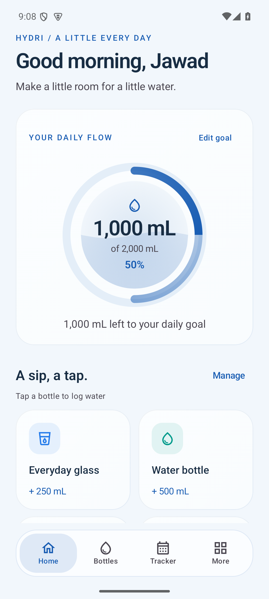

# Hydri for Android

A native, offline water tracker built with Kotlin and Jetpack Compose. No account, ads, analytics, backend, or Internet permission.

## Try Hydri on your Android phone

1. Sign into GitHub with an account that can access this private repository.
2. Open [the Android testing release](https://github.com/jawad-mohammed35/hydri-android/releases/tag/v1.0.0-test.1).
3. Expand **Assets** and download **Hydri-1.0.0-debug.apk**. Choose the APK, not the source-code archive.
4. Open the downloaded APK. If Android prompts, allow your browser or file manager to install apps, then choose **Install**.
5. Open **Hydri** and complete onboarding. The app works offline after installation.

Requires Android 8.0 or newer. This is a debug-signed testing pre-release. The release includes `SHA256SUMS.txt` for verifying the APK. No account is needed inside Hydri; GitHub sign-in is needed only to download from this private repository.



## Open and run

1. Clone this repository, then in Android Studio choose **Open** and select its root folder (the folder containing `settings.gradle.kts`).
2. Use JDK 17 for Gradle. Install Android SDK Platform 35 and accept SDK licenses if prompted. The Gradle wrapper downloads Gradle 8.11.1 and the pinned build dependencies on the first build. Building needs Internet access; using Hydri does not.
3. Allow Gradle sync, select the **app** run configuration, and select an API 26+ emulator in Device Manager. API 35 is recommended for initial testing.
4. Press **Run**. On first launch, complete the seven short setup steps.

`local.properties` is machine-specific and ignored. Android Studio generates it automatically. On another computer, do not reuse the included local SDK path.

## Build and install from a terminal

PowerShell, from the project folder:

```powershell
.\gradlew.bat assembleDebug
adb install -r .\app\build\outputs\apk\debug\app-debug.apk
adb shell am start -n com.hydri.app/.MainActivity
```

Alternatively, drag the debug APK onto a running Android Emulator. Debug builds use Android's ordinary development signing configuration; no release signing secrets are generated or committed. Rebuild after changes with `gradlew.bat assembleDebug`, or press Run in Android Studio.

On this computer, you can also start the existing virtual device without Android Studio:

```powershell
& "$env:ANDROID_HOME\emulator\emulator.exe" -avd mihraya_test
```

The headless emulator used for verification was stopped after testing. Hydri remains installed on that AVD with its generated sample data cleared, ready for the welcome flow when you next launch it.

The APK is at `app/build/outputs/apk/debug/app-debug.apk`. A convenient named copy is delivered in `deliverables/` after verification.

## Features

- Seven-step setup: nickname, measurements, goal, bottle presets, reminders, appearance.
- Four floating navigation tabs: Home, Bottles, Tracker, More.
- One-tap bottle logging, custom amounts, snackbar undo, entry edits/deletes, and manual past-day logging with date/time pickers.
- Bottle creation, names, volumes, seven icon choices, six colors, favorites, and reorder controls.
- Monthly calendar, day details, daily/weekly/monthly interactive bar charts, averages, completion rates, current/longest streaks, six consistency achievements.
- Dated daily goals, themes (system/light/dark), OLED backgrounds, six accents, reduced motion, haptics, metric/US fl oz, date/time preferences.
- Approximate WorkManager reminders, active hours, quiet hours, weekdays, stop-at-goal, evening check-in, completion notifications, sound/vibration preferences, permission-aware notifications.
- Small and medium Glance widgets; medium includes quick-add actions for the first two favorite bottles.
- CSV export and versioned JSON backup/restore through Android's file picker, explicit destructive confirmations, offline health reference and library acknowledgments.

## Data and calculation rules

- Volumes use integer **microlitres**. One US fl oz = 29.5735295625 mL; input rounds to the nearest microlitre. Display rounding never rewrites stored values. Inputs accept 1–20,000 mL or equivalent. This is an input bound, not an intake recommendation.
- Entries store an instant, original zone, and explicit local date. Traveling does not move previously logged water between days. New entries use the current zone. Historical timestamps and edits use the entry's original zone, shown in the editor and beside times when traveling. Amount-only edits preserve the original instant, including during a DST overlap. A changed date/time uses Java time's standard gap/overlap resolution.
- Home follows the current local date and updates while open. Historical records are retained at midnight. Goals are effective from their stored local date until the next goal change; changing today's goal preserves earlier values. Empty dates after tracking began count as incomplete. Backdating the first record extends tracking to that date using the earliest goal.
- A day counts once when its total meets its goal. More water earns no extra streak credit. An unfinished today does not break yesterday's ongoing streak. A missed past day does. Badges are derived from records on each update; editing or deleting entries can revoke a badge or change its unlock date. This rule is visible in Tracker.
- Calendar weeks begin Monday. Week charts show the trailing seven days. Monthly charts show the displayed calendar month through today. Daily charts show the selected date. Averages include all tracked elapsed dates in that period, including zero-intake days and today.
- Data is in app-private Room and DataStore files. Android automatic cloud backup is disabled. JSON backups include entries, dated goals, bottles and preferences; imported files are limited to 10 MB and validated before replacement. CSV includes volume, effective goal, original zone and UTC timestamp. CSV is an export, not a restore format.

## Reminder behavior

WorkManager survives process death and device reboot. Delivery is approximate; Doze, battery restrictions and manufacturer policies may delay it. Active/quiet hours and weekday checks use the local time at delivery, including time-zone changes. Equal start/end means the whole day; quiet hours take precedence. No selected weekdays means no reminders. Evening checks target 20:00 local and are suppressed outside the configured windows or when the goal is reached. Completion notifications fire when logging crosses today's goal, including widget logging; entry edits do not create celebrations. Undoing and recrossing can notify again.

Notification permission is requested when enabling reminders or completion notifications. If blocked, use More → Android notification settings. Android owns channel preferences and can override sound/vibration settings. Hydri requests neither exact-alarm access nor broad storage access.

## Widgets

Long-press the Android launcher → Widgets → Hydri. Choose daily progress or progress with favorite bottles. Updates occur after in-app changes, widget quick-add, date/time broadcasts, and a periodic refresh. Android may delay background updates around midnight. Open Hydri to refresh immediately. Widget colors follow the system theme; Android widget capabilities differ from Compose screens.

## Source layout

```text
app/src/main/java/com/hydri/app/
  MainActivity.kt, HydriApplication.kt
  data/          Room entities/DAO, DataStore settings, repository, backup/CSV
  domain/        conversion, formatting, streaks and reminder-window rules
  ui/            ViewModel, design components, onboarding, dialogs, four pages
  background/    WorkManager, time receiver, Glance widgets and actions
app/src/main/res/       vector icon, theme, widget definitions
app/src/main/assets/    bundled license texts
app/src/test/           JVM calculation tests
app/src/androidTest/    emulator repository and Compose interaction tests
docs/                   verification report and screenshots
```

Developer identity is configurable in `DeveloperInfo` in `MoreScreen.kt`. Version comes from `BuildConfig`. Add new library attributions to `THIRD_PARTY_NOTICES.md` and the in-app list. Add Room migrations when the schema changes; there is no destructive migration fallback.

## Tests

```powershell
.\gradlew.bat testDebugUnitTest
.\gradlew.bat connectedDebugAndroidTest
.\gradlew.bat lintDebug
```

Device tests require an unlocked, running emulator. The end-to-end UI test **resets this app's test-device data**. Run it on an emulator, not a phone with personal history. It deliberately leaves a little sample data for inspection. Repository tests use temporary databases and restore the preferences they change.

See `docs/VERIFICATION.md` for actual executed results, environment details, and remaining verification limitations. A successful build is not a substitute for the owner's testing across devices.

## Release status

GitHub hosts the source and a debug-signed testing pre-release in the owner's private repository. APK binaries are attached to releases and excluded from source control. No release keystore or credentials are stored in the repository. Production signing, wider distribution, and the project's source license remain future owner decisions.
