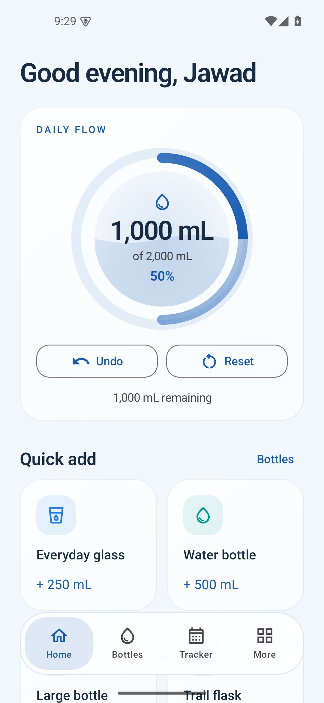
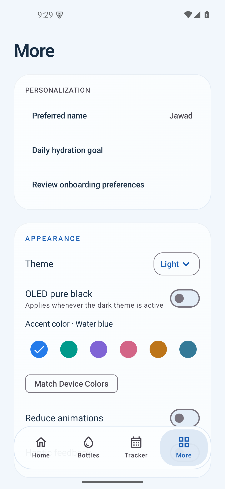

# Hydri

**Water tracking, kept simple.**

A native Android water tracker with quick logging, useful history and a quiet Liquid Glass interface. Your hydration data stays on your device. No account, ads or analytics.

**[Download the latest stable release](https://github.com/jawad-mohammed35/hydri-android/releases/latest)** · Android 8.0+ · Developed by [Jawad Mohammed](https://www.linkedin.com/in/jawad-mohammed01)

## Made for daily use

- Log water in one tap with favorite bottles, or enter a custom amount. Undo a log or swipe a sip away in either direction.
- Create bottles with your preferred volume, name, icon and color. Set a daily goal that suits you.
- Explore intake through an interactive calendar, expandable history, charts, streaks and badges.
- Choose Light, Dark, OLED Black or Follow System, with six accent colors or Android 12+ Material You colors.
- Set hydration reminders, active hours and quiet hours with themed time controls.
- Add responsive home-screen widgets and log from them without opening Hydri. Launcher shortcuts open logging, bottle creation or Tracker directly.
- Use the app offline. JSON backups and CSV exports are available when you need them.

The floating navigation bar supports taps and sliding gestures, with optional haptics and reduced-motion settings. Dialogs share rounded glass surfaces and adapt to your theme.

Hydri supports **English, Español, Français, 简体中文, 한국어, 日本語 and Bahasa Indonesia**. Choose a language or Follow System in **More → Settings → Language**, or through Android 13+ per-app language settings. Translations are bundled offline; changing languages preserves your records and measurement preferences.

## Screenshots

Real Android emulator captures using sample data:

 

## Download and install

1. Open [the stable release](https://github.com/jawad-mohammed35/hydri-android/releases/latest) on your phone and download **Hydri-1.3.0.apk** from Assets.
2. Open the APK. If Android asks, allow your browser or file manager to install apps, then choose **Install**.
3. Open Hydri. Existing users should install over the current app **without uninstalling**, so records and preferences stay intact.

Releases include a SHA-256 checksum. This version retains the existing signing certificate for update compatibility; it still uses the original Android testing identity. Read the [signing and backup guide](docs/SIGNING.md) for its limitations and maintenance requirements. Open the updated app once to register launcher shortcuts.

## Privacy

Hydri stores entries, bottles and settings in app-private Room/DataStore storage. It has no Internet permission, backend or account system. Automatic Android cloud backup is disabled. Reminders and widgets use native Android services; Android may delay background reminders depending on battery settings.

You control manual backups and exports through Android's file picker. Those files can contain names and hydration history, so keep them private when saving or sharing. Source-reference and LinkedIn links open your browser or the relevant external app.

## Development

Hydri uses Kotlin, Jetpack Compose, Material 3, Navigation, Room, DataStore, WorkManager and Glance. Use JDK 17 and Android SDK 35. The Gradle 8.14.6 wrapper is checksum-pinned.

```powershell
.\gradlew.bat assembleDebug
.\gradlew.bat testDebugUnitTest lintDebug
adb install -r .\app\build\outputs\apk\debug\app-debug.apk
```

See [development and data rules](docs/DEVELOPMENT.md) for setup, calculations, QA safeguards and release-build requirements. The original signing file is required for compatible owner release builds; it is never distributed with the source. [Version 1.3.0 verification](docs/VERIFICATION-1.3.0.md) records the tested scope.

Bug reports and contributions are welcome. Discuss larger changes with the maintainer before starting. Contributions intentionally submitted for inclusion are under Apache 2.0 unless explicitly stated otherwise and agreed with the maintainer. Please use [private security reporting](https://github.com/jawad-mohammed35/hydri-android/security/advisories/new) for vulnerabilities and never attach credentials or personal backups to public issues.

## License and credits

Hydri is licensed under the [Apache License, Version 2.0](LICENSE). Copyright 2026 Jawad Mohammed. You may use, copy, modify and redistribute it, including commercially, subject to the license's conditions. The license does not grant general trademark rights or imply endorsement. Third-party components retain their own notices and licenses; see [NOTICE](NOTICE) and [third-party credits](THIRD_PARTY_NOTICES.md).

Developed by **Jawad Mohammed**. Thanks to the AndroidX, Kotlin, Material Icons and other library contributors; their notices are preserved in [third-party credits](THIRD_PARTY_NOTICES.md). Hydration Guide references identify their original authorities and recommendation dates. No affiliation or endorsement is implied.

For licensing before v1.2.3, see [the historical licensing review](docs/LEGACY-LICENSING.md).
