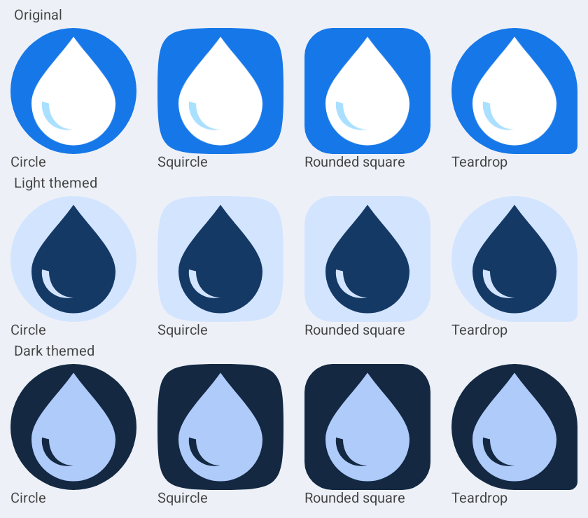

# Hydri launcher icon

The original blue field, white droplet and small pale-blue reflection are retained. The droplet is slightly shorter to fit the adaptive safe zone cleanly. No bitmap, new illustration, gradient or shadow is used.

- `drawable/ic_launcher_background.xml`: full-bleed blue layer, without a pre-applied mask.
- `drawable/ic_launcher_foreground.xml`: transparent 108dp vector with a centered 48 × 62dp droplet. All visible pixels fit inside the central 66dp-diameter safe circle.
- `drawable/ic_launcher_monochrome.xml`: independent single-color silhouette with a transparent reflection cutout; the launcher supplies its theme colors.
- `mipmap-anydpi-v26/ic_launcher.xml`: adaptive icon for Android 8–12.
- `mipmap-anydpi-v33/ic_launcher.xml`: adaptive icon with monochrome support for Android 13+.
- `mipmap-anydpi/ic_launcher.xml`: scalable rounded-square legacy fallback; Hydri's minimum supported Android version remains 8.0/API 26.

Both manifest icon attributes use the same adaptive resource, allowing each launcher to apply its own circle, squircle or other mask. The existing in-app logo remains unchanged. Launcher theming follows device/launcher preferences independently of Hydri's in-app appearance settings.

Native Android tests inspect the installed package icon, background/foreground/monochrome layers, visible-pixel safe-zone bounds, and rendering at 24/48/96/192px. They also render original, light-themed and dark-themed layers through circle, squircle, rounded-square and teardrop sample masks. These rendering studies demonstrate the actual Android vector resources; they are not screenshots of different manufacturers' launchers. Physical Samsung/third-party launcher coverage is not claimed.

The implementation follows [Android's adaptive icon guidance](https://developer.android.com/develop/ui/compose/system/icon_design_adaptive). Android 13+ themed icons require a supporting launcher and its themed-icons setting to be enabled.

