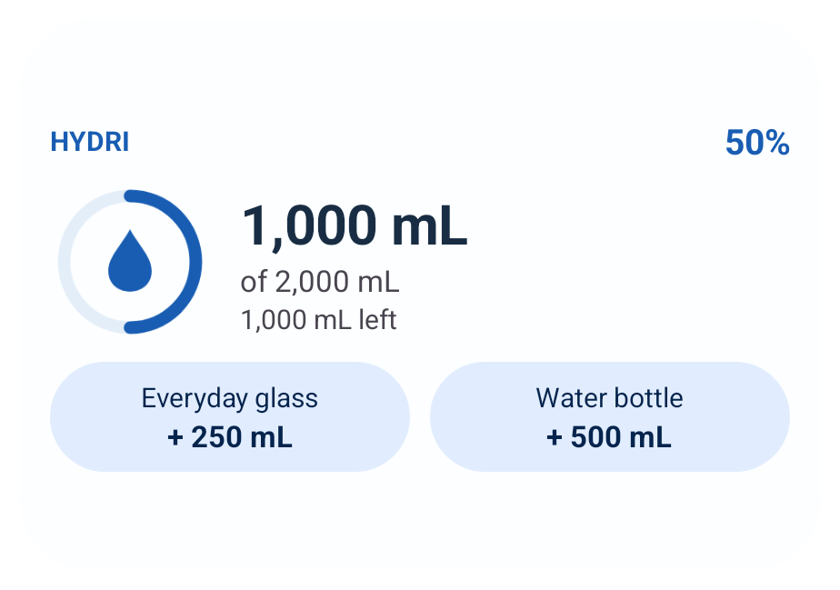
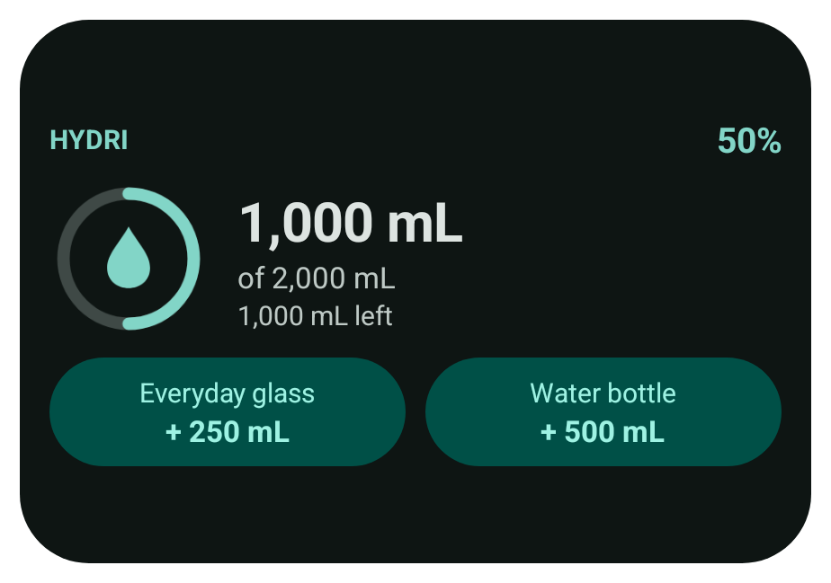
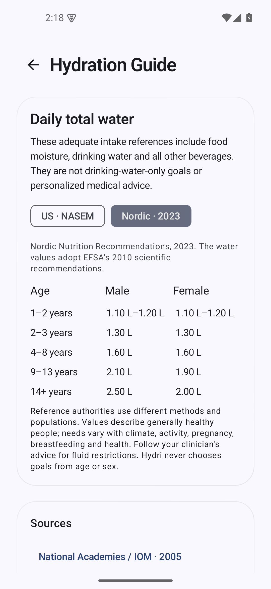

# Hydri 1.2.0 verification

Date: October 29, 2026. Version name **1.2.0**, code **3**. Application source: `022b2f9` (after `b131594`).

## Changes

- More pages use horizontal spring transitions with reversed pop transitions. Back arrows, Android back buttons and an actual system edge-back gesture use the same navigation stack. Hydri's reduced-motion preference and Android animator scale are respected.
- The bottom indicator tracks horizontal dragging, switches pages as tab boundaries are crossed, and springs into place on release. Tap, tab-selection accessibility semantics, RTL mapping and optional haptics remain available.
- Match Device Colors shares native Material You palettes between Compose and widgets on API 31+. Existing accent preferences remain stored; selecting a preset disables dynamic colors. Earlier Android versions fall back to Water blue.
- Widgets have six native responsive layouts, rounded surfaces, progress graphics and favorite-bottle controls when space permits. App appearance, OLED black and units are shared. Native resource colors handle palette changes; a local, documented Glance resource-provider compatibility bridge is scoped to `WidgetColors`.
- Live widget compositions observe preferences, today's entries, goals and bottles. All app mutations and widget actions request refresh. Widget actions write to the offline repository without launching an activity. Existing date/time broadcasts and one 30-minute worker cover inactive widgets; duplicate framework polling is disabled.
- Appearance controls now apply each change to the latest stored settings, preventing rapid changes from overwriting one another.

## Hydration references

Primary sources checked October 29, 2026:

- [Institute of Medicine / National Academies, 2005](https://www.nationalacademies.org/read/10925/chapter/6): established US age/sex adequate-intake values retained, including adult total water of 3.7 L for males and 2.7 L for females.
- [Nordic Nutrition Recommendations, 2023](https://pub.norden.org/nord2023-003/fluid-and-water-balance.html): separate reference table adopting EFSA's **2010** recommendations, including 2.5 L for males and 2.0 L for females aged 14+. The guide identifies both publication dates and does not present the Nordic values as a replacement for the US values.
- [CDC, Water and Healthier Drinks, updated March 5, 2026](https://www.cdc.gov/healthy-weight-growth/water-healthy-drinks/): current context about changing needs and food/beverage contributions; that webpage date is explicitly distinguished from numerical recommendation dates.

The tables describe **total water including food moisture and all beverages**, rather than drinking water alone. Hydri asks for neither age nor sex and does not derive a personal goal from the tables. Canonical microlitres convert through the existing formatter into mL, L or US fluid ounces without changing stored values.

## Build and emulator checks

Builds used JDK 17, Gradle 8.11.1 and SDK 35. `assembleDebug`, `assembleRelease`, `assembleDebugAndroidTest`, `testDebugUnitTest`, `lintDebug` and `lintRelease` succeeded. Lint reported **0 errors and 22 warnings** per variant; warnings include existing deprecations and dependency/tooling suggestions.

**19 JVM tests passed:** conversion, dates/DST, goals, statistics, reminders, tab boundary/RTL calculations, source values and guide formatting.

Device verification used only the separate `hydri_refinement_qa` Android 15/API 35 emulator, serial `emulator-5580`. Existing virtual devices and personal phone data were untouched. The release variant, rather than just a debug build, was installed for device checks.

**20 device tests passed** on the final release APK at 1080×2340, 440 dpi, default text size:

- In-place upgrade preserves records, preferences and badge results.
- Drag across all tabs while the pointer remains down, reverse drag, then tap.
- Measured incoming/outgoing slide positions, toolbar back, Android back key and a shell-injected system edge-back gesture; reduced-motion placement.
- Device-color selection, rapid appearance changes, OLED black and live guide unit switching; choosing a custom preset disables dynamic colors.
- Both widget providers at 100×80, 160×120, 160×200, 240×110, 240×160 and 320×220 content dp. Checked quick-add availability and captured native host screenshots.
- Real widget button PendingIntent writes water without creating an activity; displayed totals refresh after widget/app logging, edits, deletion, restoration/Undo, goal changes and today-only reset.
- App-selected themes/accents match widget text colors. Changing Android's Material You palette and system night mode updates native widget colors. QA palette/night settings are restored afterward.
- Existing onboarding, immediate theme preview, settings pages and dropdowns, bottle editors/favorites, swipe deletion/Undo, daily Undo/Reset, fixed-date/time edits, expandable history, backups, badges and reminder behavior.

**10 additional UI tests passed** at 720×1280, 320 dpi (**360×640 dp**), **1.3 font scale**, covering the five navigation/appearance tests and five existing interaction flows. The emulator size, density and text scale were restored afterward. Visual review included the guide, tab bar and responsive widget screenshots. [Recorded results](test-results-1.2.0.txt).

## Data and signing

A repository snapshot was captured by instrumentation against the installed **1.1.0 release before upgrading**, using synthetic QA records. Upgrade checks compare every entry, bottle field, dated goal, existing preference value and derived badge statistics. The database schema remains version 1; no migration or destructive fallback was introduced. The added preference is optional and defaults to false when reading old settings and backups. Scenario tests restore their snapshots afterward.

The non-debuggable release reuses the original testing certificate. Its SHA-256 fingerprint is `ed0e989eaa47ed777d32e9dcc9902f4462d349f5ad132bb8568971383b3ec9f0`. The existing build guard rejects a missing or different key. No replacement key, credentials, new account service or network permission was added.

APK SHA-256: `e0c5a50746151a5b660f4881fe531f6ca36e02f57ac932f5d7b90e7ae32b3046`.

## Published artifact

Release v1.2.0 was published in the existing public repository, preserving its history and both previous releases. Hydri-1.2.0.apk is 13,300,872 bytes. An anonymous download matched the checksum above and passed `apksigner verify` with the original certificate. Installing that downloaded APK with `adb install -r` succeeded; the upgrade-preservation test passed again against it. The release remains a testing pre-release because it intentionally reuses the existing testing signing identity.

## Limits

Widget rendering and real PendingIntent clicks were tested through Android's native `AppWidgetHostView`, including small, tall and wide layouts. This does not establish compatibility with every manufacturer's launcher. No physical-phone test, API 26–30 runtime test, TalkBack session, subjective haptic assessment or long-duration performance benchmark was performed. Pre-Android-12 dynamic-color fallback is guarded in code and lint-checked. Reduced-motion device testing covered Hydri's setting; Android animator scale also disables Compose animation through the platform's duration scale.

## Screenshots

Maintenance note (October 30, 2026): this old pre-release entry and APK were removed after verification of stable 1.2.3. The [v1.2.0 source tag](https://github.com/jawad-mohammed35/hydri-android/tree/v1.2.0) remains. The results above describe the original release; see [cleanup record](RELEASE-HISTORY.md).
