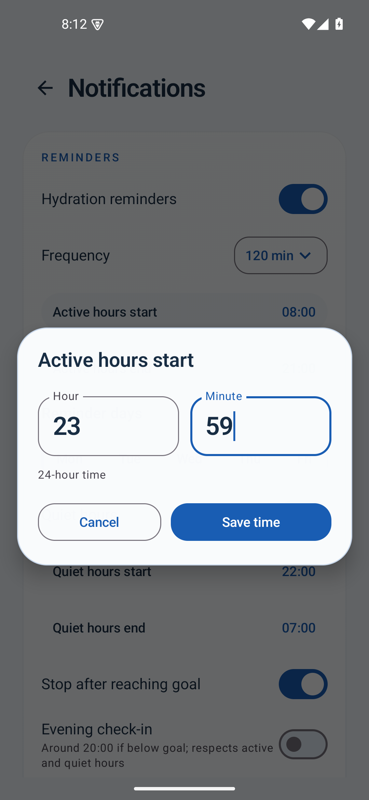
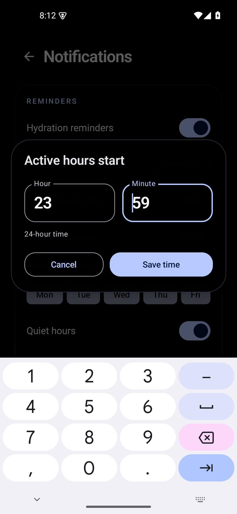
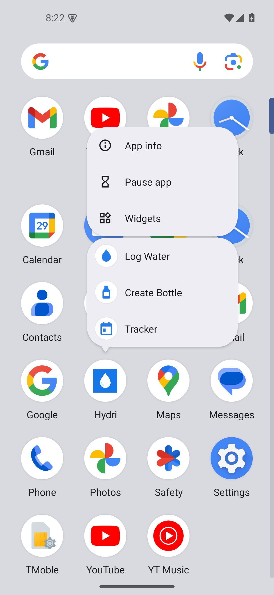

# Hydri 1.2.1 verification

October 29, 2026. Version **1.2.1**, internal code **4**. Application changes: `2f36d4e`.

## Refinements

- Primary destinations share one navigation function. Quick Add's Bottles links, tab taps/drags and launcher actions update the actual navigation stack; the selected tab comes from its current destination. Home is always the root rather than a restored stack containing another page. Other tabs retain their scroll state.
- Individual tab touch ripples are disabled. The rounded glass indicator supplies selection feedback; a separate rounded focus outline and standard tab semantics preserve keyboard/accessibility navigation.
- Notifications uses an animated glass time editor with hour/minute inputs, validation, AM/PM, preferred/system 12/24-hour format, Save/Cancel, current theme/accent, safe insets and keyboard-aware scrolling. Reminders still store minutes since midnight.
- Successful quick/custom logging no longer emits a Snackbar. Water progress and optional haptics remain; Daily Flow Undo, deletion Undo and error messages remain available.
- Today's Sips accepts native horizontal dismissals in either direction, with the delete background aligned to the swipe. Entry-editor deletion is immediate and closes the editor; day resets and bulk deletion still require confirmation.
- About displays “Developed by Jawad Mohammed” and opens the supplied LinkedIn profile with an Android browser/app intent. The footer displays only the version name.
- Three native Android `ShortcutManager` shortcuts provide Log Water, Create Bottle and Tracker. They are registered after opening the updated app, use explicit single-activity task flags, handle `onNewIntent`, wait for onboarding if needed and mark requests consumed to prevent replay after recreation. No extra activity, dependency, permission or service was added for shortcuts.

## Build and signing

JDK 17, Gradle 8.11.1, SDK 35. Debug/release APK builds, Android-test APK compilation, JVM tests and debug/release lint succeeded. Lint reported **0 errors and 22 warnings** in each variant, including existing tooling/deprecation suggestions.

**19 JVM tests passed:** conversions, date/DST rules, goals, statistics, reminder windows, navigation boundary/RTL calculations and guide formatting.

The APK is non-debuggable, minimum API 26, target API 35. `apksigner verify` confirms the original certificate fingerprint: `ed0e989eaa47ed777d32e9dcc9902f4462d349f5ad132bb8568971383b3ec9f0`. The existing signing guard remains; no key was created or exposed. The GitHub release is designated **stable**, while retaining the original Android testing certificate for compatibility with installed Hydri versions.

## Device verification

Tests ran only on the separate Android 15/API 35 `hydri_refinement_qa` emulator (`emulator-5580`) using the release APK. Personal devices and existing virtual devices were not reset. Scenario tests restore their saved repository snapshots.

**29 tests passed** on the final release APK at 1080×2340 / 440 dpi / font scale 1.0:

- Upgrade preservation: 1 test.
- New refinements: 6 tests covering repeated Home → Bottles → Home, silent logging with daily Undo, both swipe directions with deletion Undo, immediate editor deletion, developer/footer content, and time-picker themes, formats, validation, Save and Cancel. Pixel comparisons confirm no tab touch ripple; a real keyboard Tab event plus focus request verifies retained keyboard focus.
- Launcher lifecycle: 3 tests covering each destination from a closed activity, repeated/warm/background launches reusing the same activity, onboarding deferral, and no replay after recreation. Unit and theme preferences are respected.
- Existing navigation/appearance: 5 tests, including dragging, system back gestures, reduced motion, live guide units and rapid preference changes.
- Widgets: 3 tests, including live updates, actual button actions, six sizes, app themes, device palette and system night changes.
- Existing interaction flows: 5 tests for onboarding, settings/dropdowns, bottle editing/favorites, tracking/Undo/Reset, date/time edits and expandable history.
- Repository/reminders: 6 tests for stored data, backup/restore validation, statistics/badges, widgets and reminders.

**16 additional UI tests passed** at 720×1280 / 320 dpi (**360×640 dp**) / **1.3 font scale**: all 6 new refinement checks, 5 navigation/appearance checks and 5 existing flows. Visual review confirmed the time editor's actions remain above the keyboard on this layout. QA screen size, density and text scale were restored afterward. [Recorded results](test-results-1.2.1.txt).

Additional external checks exercised each action after force-stopping the QA process, plus a normal cold launch without replay. The emulator launcher's actual long-press popup displayed all three labels/icons, and tapping each action opened its corresponding editor/page. Native shortcut inspection confirmed stable IDs, enabled state, explicit target intents and resource icons. These checks supplement ActivityScenario lifecycle assertions rather than replacing them.

## Upgrade preservation

Before installing 1.2.1, instrumentation captured a complete repository backup against the installed **1.2.0 release**. Upgrade verification compares every entry, bottle field, dated goal, preference value and derived badge/statistics result. The Room schema remains version 1; no migration, destructive fallback or preference reset was needed. The APK installs with `adb install -r`, preserving application data.

APK SHA-256: `874ff2172952d516b78126bc3c9f0bbc07abf584b5c2f2868f1bd77c3b0dedea`. Size: 13,303,616 bytes. The final APK was built after test-harness synchronization commit `9fce26f`; application sources are unchanged from `2f36d4e`.

## Limits

No physical Samsung/One UI device or other vendor launcher was available. Native launcher checks used the emulator's launcher; the implementation uses official Android APIs supported by compatible launchers. Keyboard focus and touch rendering were checked, but no TalkBack session or subjective haptic assessment was performed. There was no long-duration performance benchmark or runtime test on older Android versions. Existing app permissions and the offline data architecture remain unchanged.

## Screenshots

