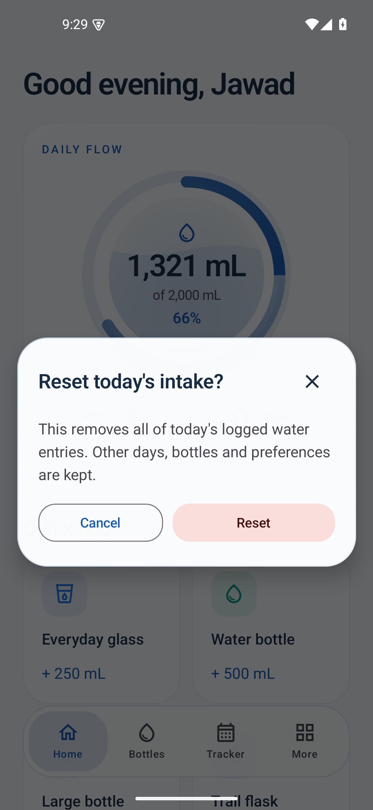
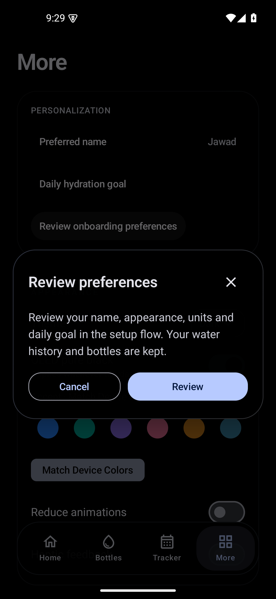

# Hydri 1.2.2 verification

Version **1.2.2**, internal code **5**. Application source `b001f56`, building on `cce7628`; security/tooling changes `7247f19`. Reviewed October 29, 2026 in New York (October 30 UTC).

## UI changes

- Reset Today's Intake, Preferred Name and Review Preferences use a shared rounded glass dialog with restrained transparency, theme/accent colors, animated entrance/dismissal, keyboard insets, scrolling, accessible labels and clear actions. Existing bottle, water and goal editors reuse the same surface component. Reduced-motion settings disable its transitions.
- Reset explains today's deletion, offers Cancel/Reset and retains other days. Cancel preserves records. Preferred Name preserves chosen capitalization, keeps keyboard capitalization hints and discards canceled edits when reopened. Review opens the existing setup flow while preserving history and bottles.
- Personalization labels and values use normal on-surface text colors. Accent use elsewhere is retained.
- The main viewport now draws beneath the oval navigation instead of ending above a full-width reserved strip. End padding keeps final content reachable. Native bring-into-view behavior accounts for the overlay so keyboard-focused controls move above it. Tab taps, dragging, selection, haptics and focus outlines remain.
- The oval uses a restrained translucent/frosted tint and outline. **True real-time backdrop blur is not implemented.** This is the requested performant fallback: no repeated background screenshots or effects that blur navigation icons/text. Content remains visible around and subtly through the oval.

## Build and automated tests

JDK 17, Android SDK 35 and patched **Gradle 8.14.6**. Debug, release and Android-test APKs built successfully; debug/release lint passed with **0 errors, 22 warnings** per variant. Gradle reports existing deprecations for a future Gradle 9 migration; this update stays on Gradle 8. Both the distribution and regenerated wrapper JAR match official checksums. Windows transform-cache file locks required local retries/recovery after Gradle exited; no antivirus settings were disabled.

**19 JVM tests passed**, covering volume/date calculations, goal/statistics/badge behavior, reminders, tab boundaries/RTL mapping and guide formatting.

**33 device tests passed** on the release APK using the isolated Android 15/API 35 QA emulator at 1080×2340, 440 dpi, font scale 1.0. The suite comprises upgrade preservation (1), new dialog/typography/floating-bar checks (4), prior refinement checks (6), launcher lifecycle (3), navigation/appearance (5), widgets (3), existing interaction flows (5) and repository/reminders (6).

**20 additional UI tests passed** at 720×1280, 320 dpi (**360×640 dp**), **1.3 font scale**. These include all 4 new polish checks, 6 prior refinements, 5 navigation/appearance checks and 5 existing interaction flows. Light, Dark, OLED and Material You were exercised. Preferred-name input was focused with the keyboard open, and Save/Cancel remained accessible. Actual screenshots were visually reviewed.

The floating-bar checks verify that content extends behind navigation, end padding lets the footer clear the bar, and a focused control moves above the overlay. Touch tests explicitly scroll controls clear of the floating sibling before tapping; ordinary viewport scroll-to semantics alone do not account for sibling overlays. Existing date-fixed edits, history expansion, deletion/Undo/Reset, favorites, reminders, badges, launcher shortcuts and widget synchronization were retained. [Recorded results](test-results-1.2.2.txt).

## Upgrade and signing

Instrumentation captured the installed **1.2.1** release's repository before update: **2 entries, 4 bottles, 1 dated goal**, plus all preferences and derived badge/statistics results. The signed update preserved them. Scenario tests restore snapshots; no personal device or other AVD was reset. Room remains schema version 1 with no destructive fallback or migration required.

The release APK is non-debuggable and retains the original Android testing certificate. SHA-256 certificate fingerprint: `ed0e989eaa47ed777d32e9dcc9902f4462d349f5ad132bb8568971383b3ec9f0`. No signing key was generated, replaced, committed or uploaded. [Private backup/signing guidance](SIGNING.md) explains the remaining long-term signing concern.

APK size: **13,319,996 bytes**. SHA-256: `5e1b0a3836a615b1bf8a3cf65bc477a28b94e545d30446b2e61aa0409ade51cb`.

## Repository review

The [security/licensing review](SECURITY-AND-LICENSING.md) records the checked scope, primary references and approval-dependent decisions. Source licensing and public visibility were not changed. Secret scanning, push protection and private vulnerability reporting are enabled. Ignore rules were strengthened; signing and private data remain outside Git. The runtime dependency inventory has 91 coordinates and no OSV advisories returned at review time; Gradle's separate published build-tool advisory was addressed by the wrapper update.

The README now uses the existing logo, real sample-data emulator captures, clear download instructions, accurate privacy claims and an explicit licensing-under-review statement. Detailed calculation/build information is preserved in [development documentation](DEVELOPMENT.md).

## Limits

No physical Samsung/One UI device, older-Android runtime, TalkBack session or long-duration/frame-time benchmark was available. Widget and launcher behavior was tested on the emulator. Successful tests and an advisory scan are not a blanket security or performance certification. No private signing backup was made or verified outside the local active keystore; the owner must arrange and test encrypted backups.

